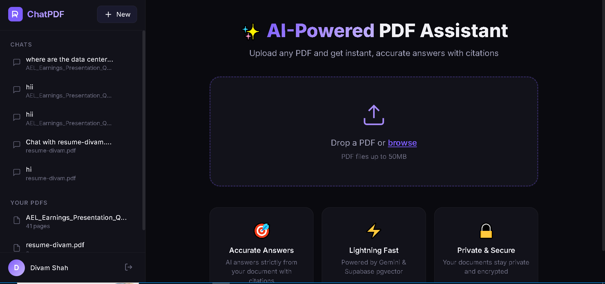
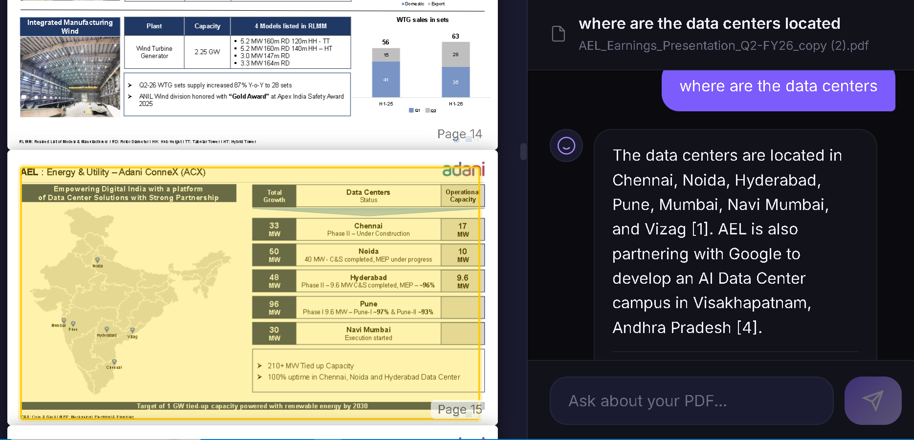
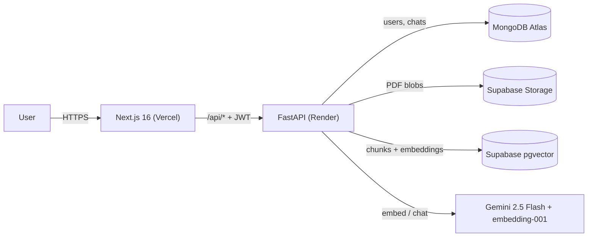
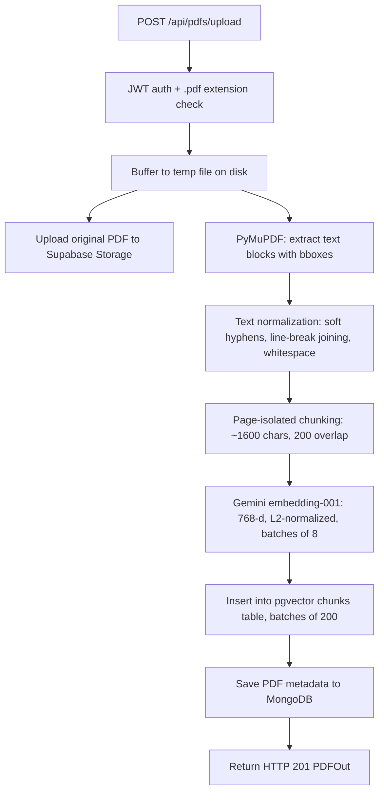
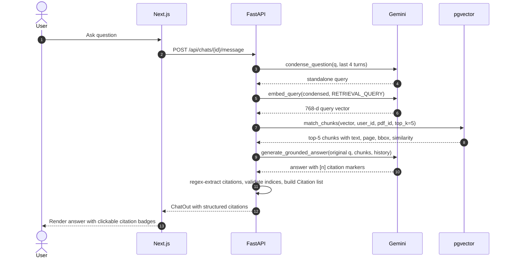
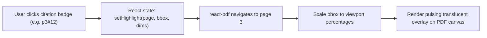

# ChatPDF — RAG-Powered Document Q&A with Cited Sources


Upload any text-based PDF and ask questions about it. Every answer is grounded exclusively in the document's content, and every cited fact links back to the **exact source rectangle** on the **exact page** — click a citation badge to scroll the in-app PDF viewer to that location and see a pulsing highlight over the source text.

**Why this project:**

1. Most PDF chat tools give answers without showing *where* the information came from. ChatPDF returns structured citations with page numbers and bounding boxes so you can verify every claim.
2. The system refuses to answer when the information is not in the document, instead of hallucinating — and it suppresses citations on refusals so you never get a fake source for a non-answer.
3. The entire stack runs on free tiers (Supabase, MongoDB Atlas M0, Gemini API, Render, Vercel) and is designed to be cloned and run locally in minutes.

---

## Screenshots

<p align="center">
  
</p>
<p align="center"><em>Landing page — drag-and-drop PDF upload with chat history sidebar and uploaded PDF library</em></p>

<br/>

<p align="center">
  
</p>
<p align="center"><em>Query interface — PDF viewer with highlighted source bbox on the left, chat with citation badges and an honest refusal on the right</em></p>

---

## Features

| Feature | Description |
| --- | --- |
| **Cited answers** | Every sentence in the answer that uses a document fact is followed by a `[n]` citation marker linking to a specific chunk. |
| **Click-to-highlight source** | Citations carry `{page, bbox, page_width, page_height}`. Clicking a badge scrolls the PDF viewer to that page and paints a pulsing overlay over the exact source rectangle. |
| **Follow-up question condensation** | Follow-up questions like *"break that down"* are silently rewritten into standalone queries (using the last 4 conversation turns) before retrieval, so the vector search pulls the right chunks. |
| **Refusal guard with citation suppression** | When the answer is not in the document, the model returns the exact string `"I could not find that in the document."` and the code suppresses all citations — no fake sources for hallucinated answers. |
| **Code-side citation validation** | A regex extracts all `[n]` markers from the model's output and validates that each index is in `1..len(retrieved)`. Out-of-range indices are silently dropped. If the model forgets to cite, the top-1 chunk is used as a fallback. |
| **JWT auth with per-user, per-PDF isolation** | `python-jose` HS256 tokens + `passlib[bcrypt]` password hashing. Every pgvector retrieval is scoped to `(user_id, pdf_id)` so users never see each other's data. |
| **Retry with exponential backoff and jitter** | Every Gemini API call wraps a 5-attempt retry that honours the server's `retry in Ns` hint. Free-tier RPM throttles don't break uploads. |

---

## Architecture

### High-Level System Diagram



### Ingestion Pipeline (PDF Upload)



### Chat + Citation Flow (Question Answering)



### Citation Highlighting Flow



### Component Table

| Component | Technology | Role |
| --- | --- | --- |
| Frontend | Next.js 16, React 19, react-pdf 10.4.1 | UI, PDF rendering, citation highlight overlays |
| Backend API | FastAPI, Uvicorn | REST API, request routing, auth middleware |
| PDF parsing | PyMuPDF (fitz) | Text block extraction with bounding boxes |
| Embeddings | Gemini `gemini-embedding-001` (768-d) | Document and query vectorization |
| Chat LLM | Gemini `gemini-2.5-flash` | Question condensation and grounded answer generation |
| Vector store | Supabase PostgreSQL + pgvector | Chunk storage, IVFFlat cosine similarity search |
| App database | MongoDB Atlas (motor async driver) | Users, chats, messages, PDF metadata |
| File storage | Supabase Storage | Raw PDF binary files |
| Auth | python-jose (JWT HS256) + passlib[bcrypt] | Token-based authentication, password hashing |

---

## How It Works

### 1. Ingestion

When a PDF is uploaded, the backend:

1. **Validates** the JWT token and checks the file has a `.pdf` extension.
2. **Buffers** the file to a temporary directory on disk (cleaned up in a `finally` block).
3. **Uploads** the raw PDF to Supabase Storage at `{user_id}/{pdf_id}/{filename}`.
4. **Extracts** text blocks using PyMuPDF's `page.get_text("blocks")`, keeping only `block_type == 0` (text, not images). Each block comes with `(x0, y0, x1, y1)` bounding box coordinates in PDF points (1 pt = 1/72 inch), page number (1-indexed), and page dimensions.

### 2. Cleaning

The `_clean()` function normalizes raw text:
- Removes soft hyphens (`\xad`).
- Joins hyphenated line breaks (`optimi-\nzation` → `optimization`) only when followed by a word character.
- Converts single newlines to spaces while preserving paragraph breaks (double newlines).
- Collapses runs of whitespace.

### 3. Chunking

**Why 1600 / 200 / 120?**
- **1600 characters** ≈ 400 tokens — comfortably under `gemini-embedding-001`'s 2048-token context limit, large enough for coherent passages.
- **200-character overlap** preserves context across chunk boundaries so retrieval doesn't miss sentences that straddle two chunks.
- **120-character minimum** filters out stray headers, page numbers, and noise that would waste embedding API calls.

**Why page-isolated chunks?** Chunks never cross page boundaries. This guarantees each chunk maps to exactly one page and one bounding box, so the frontend can highlight a single rectangle on a single page. The bounding box is the **union** of all block-level boxes within the chunk: `[min(x0), min(y0), max(x1), max(y1)]`.

Spans on each page are sorted in reading order by `(round(y0, 1), x0)` — top-to-bottom, then left-to-right.

### 4. Embeddings

- **Model**: `gemini-embedding-001` at 768 dimensions (Matryoshka reduction from 3072).
- **L2 normalization**: Because Matryoshka truncation breaks the unit-length property, every vector is re-normalized: `v_norm = v / ||v||_2`. After normalization, inner product equals cosine similarity.
- **Task types**: `RETRIEVAL_DOCUMENT` for stored chunks, `RETRIEVAL_QUERY` for user questions. This asymmetric encoding trains the model to align questions with answer passages.
- **Batching**: 8 texts per API call to stay within free-tier TPM limits.
- **Retry**: Up to 5 attempts with exponential backoff + jitter, honouring the `retry in Ns` hint from Gemini's 429 responses.

### 5. Retrieval

- **RPC**: `match_chunks(query_embedding, p_user_id, p_pdf_id, match_count)` — a PostgreSQL function using pgvector's `<=>` cosine distance operator.
- **Index**: IVFFlat with 100 lists, suitable for up to ~100k vectors.
- **Tenant isolation**: The `WHERE` clause scopes results to `(user_id, pdf_id)`.
- **Top-K**: 5 chunks by default. If zero chunks are returned, the engine immediately returns the refusal string without calling the LLM.

### 6. Grounded Generation

The system prompt instructs Gemini 2.5 Flash to:
- Answer **only** from the numbered context blocks provided.
- Append `[n]` citations after every sentence that uses a fact from block `n`.
- Reply with the exact refusal string `"I could not find that in the document."` if the answer is not in the context.

The last 6 messages of conversation history are included so the model can maintain coherence across turns. Temperature is set to 0.1 for factual consistency.

### 7. Citation Validation

A regex `\[(\d+(?:\s*,\s*\d+)*)\]` extracts all citation indices from the model's output. Each index is validated against `1..len(retrieved)`. Out-of-range indices are silently dropped. If the model produces an answer without any valid citation markers, the code defaults to `[1]` (the top-ranked chunk) so the user always has at least one verifiable source.

If the refusal string is detected in the answer, all citations are suppressed.

### 8. Highlight Coordinate Scaling

PyMuPDF uses a top-left origin with y increasing downward (same as CSS), so no y-axis flip is needed. The frontend scales the bounding box to viewport percentages:

```
left   = (x0 / page_width)  × 100%
top    = (y0 / page_height) × 100%
width  = ((x1 - x0) / page_width)  × 100%
height = ((y1 - y0) / page_height) × 100%
```

---

## Design Decisions and Trade-Offs

| Decision | Rationale |
| --- | --- |
| **pgvector instead of FAISS / Pinecone** | Runs inside the existing Supabase Postgres instance — no extra service, no on-disk index files that disappear on free-tier restarts. SQL-level tenant isolation with a simple `WHERE` clause. |
| **Two databases (Postgres + MongoDB)** | Vectors need a fixed-schema table with a cosine index (Postgres). Chat messages, user profiles, and PDF metadata are flexible, nested documents that change shape easily (MongoDB). Using each database for what it's best at. |
| **Question condensation** | Follow-up questions like *"break that down"* contain pronouns that don't match any document text. Rewriting them into standalone queries (using the last 4 turns of context) dramatically improves retrieval precision. |
| **Exact refusal string** | A deterministic refusal phrase (`"I could not find that in the document."`) makes it trivial for the code to detect refusals and suppress citations. No fuzzy matching needed. |
| **Chunks never cross pages** | Guarantees a 1-to-1 mapping between a chunk and a single page/bbox, which is required for the click-to-highlight feature. |
| **L2 normalization after Matryoshka** | Gemini's embedding model supports Matryoshka (truncated dimensions). At sub-3072 dimensions, vectors lose their unit-length property. Re-normalizing ensures `<=>` cosine distance works correctly. |
| **Batch size of 8 for embeddings** | Keeps per-request token volume low enough that Gemini's free-tier TPM limit doesn't trip on long chunks. |

---

## Limitations

These are real, known limitations — not planned features presented as bugs:

- **Scanned / image-only PDFs are rejected.** There is no OCR. The backend returns a 400 error: *"No extractable text found."*
- **Images, charts, and graphs are not processed.** PyMuPDF extracts text blocks only (`block_type == 0`). Visual content is invisible to the system.
- **Only top-5 retrieval.** Very broad questions like *"summarize everything"* may miss content spread across many pages.
- **Highlight is the union box of a chunk, not the exact sentence.** The bounding box covers the entire chunk's span of text blocks, not the specific sentence the model cited.
- **Multi-column layouts and tables may have imperfect reading order.** The sorting heuristic `(round(y0, 1), x0)` works well for single-column documents but can misorder columns.
- **Citation validation checks index range, not semantic correctness.** It confirms that a citation points to a retrieved chunk, not that the chunk truly supports the sentence.
- **Upload processing is synchronous.** Parsing, chunking, and embedding all happen inside the HTTP request — no background queue. Large PDFs may take 30+ seconds.
- **PDF storage URLs are public.** Signed URLs with expiry are a planned improvement.

## Roadmap

- [ ] OCR support for scanned PDFs (e.g., Tesseract or a cloud OCR API)
- [ ] Image and chart handling via VLM captions (at ingest time) plus answer-time vision
- [ ] Background job processing for uploads (task queue with progress polling)
- [ ] Signed URLs with expiry for private PDF file access
- [ ] Local embedding model option for fully offline operation
- [ ] Retrieval evaluation set with recall@5 metrics
- [ ] One-click deployment guide

---

## Tech Stack

### Frontend

| Layer | Technology |
| --- | --- |
| Framework | Next.js 16 (App Router, Turbopack) |
| Runtime | React 19 |
| PDF rendering | react-pdf 10.4.1 (pinned to pdfjs-dist@5.4.296) |
| Styling | CSS Modules + custom design tokens (dark theme, glassmorphism) |
| State | React Context (AuthContext) + local state |

### Backend

| Layer | Technology |
| --- | --- |
| Framework | FastAPI + Uvicorn |
| PDF parsing | PyMuPDF (fitz) — block-level text with bounding boxes |
| LLM SDK | google-genai (supported successor to google-generativeai) |
| Chat model | gemini-2.5-flash |
| Embedding model | gemini-embedding-001 at 768-d (Matryoshka), L2-normalized |
| Auth | python-jose (JWT, HS256) + passlib[bcrypt] |
| MongoDB driver | motor (async) |
| Supabase SDK | supabase-py |

### Data Layer

| Service | Role |
| --- | --- |
| MongoDB Atlas (M0 free) | Users, chats, messages, PDF metadata |
| Supabase Storage | Raw PDF binary files |
| Supabase pgvector | 768-d chunk embeddings + bbox metadata; IVFFlat cosine index |

---

## Run Locally in 5 Minutes

### Prerequisites

- **Python 3.11+** ([python.org](https://www.python.org/downloads/))
- **Node.js 20+** ([nodejs.org](https://nodejs.org/))
- **Gemini API key** — free at [Google AI Studio](https://aistudio.google.com/app/apikey)
- **Supabase project** — free at [supabase.com](https://supabase.com/) (provides Postgres + pgvector + Storage)
- **MongoDB Atlas cluster** — free M0 tier at [mongodb.com/atlas](https://www.mongodb.com/atlas)

### 1. Clone

```bash
git clone https://github.com/<!-- TODO: your-username -->/chatpdf-rag.git
cd chatpdf-rag
```

### 2. Set Up Supabase

1. In your Supabase dashboard, go to **SQL Editor** and paste the contents of [`db/setup.sql`](./db/setup.sql). Run it. This creates the `pgvector` extension, the `chunks` table, indexes, and the `match_chunks` function.
2. Go to **Storage** and create a new **public bucket** named `pdfs`.
3. Note your **Project URL** and **Service Role Key** from **Settings → API**.

### 3. Set Up MongoDB Atlas

1. Create a free M0 cluster at [mongodb.com/atlas](https://www.mongodb.com/atlas).
2. Create a database user and whitelist your IP (or use `0.0.0.0/0` for development).
3. Copy the connection string.

### 4. Configure Environment Variables

#### Backend

```bash
cd backend
```

**Windows (PowerShell):**
```powershell
Copy-Item .env.example .env
```

**macOS / Linux:**
```bash
cp .env.example .env
```

Open `backend/.env` in any editor and fill in your real values:

```env
MONGODB_URI=mongodb+srv://<username>:<password>@cluster.mongodb.net
SUPABASE_URL=https://your-project.supabase.co
SUPABASE_KEY=your_supabase_service_role_key_here
SUPABASE_BUCKET=pdfs
GEMINI_API_KEY=your_gemini_api_key_here
JWT_SECRET=paste_a_long_random_string_here
JWT_ALGORITHM=HS256
JWT_EXPIRY_HOURS=72
CORS_ORIGINS=http://localhost:3000,http://127.0.0.1:3000
```

> To generate a JWT secret: `python -c "import secrets; print(secrets.token_hex(32))"`

#### Frontend

```bash
cd ../frontend
```

**Windows (PowerShell):**
```powershell
Copy-Item .env.example .env.local
```

**macOS / Linux:**
```bash
cp .env.example .env.local
```

The default value `NEXT_PUBLIC_API_URL=http://localhost:8000` should work as-is for local development.

### 5. Install Dependencies & Start

#### Backend

**Windows (PowerShell):**
```powershell
cd backend
python -m venv .venv
.\.venv\Scripts\Activate.ps1
pip install -r requirements.txt
uvicorn main:app --reload --port 8000
```

**macOS / Linux:**
```bash
cd backend
python3 -m venv .venv
source .venv/bin/activate
pip install -r requirements.txt
uvicorn main:app --reload --port 8000
```

The backend is running at `http://localhost:8000`. Check `http://localhost:8000/docs` for the interactive API docs.

#### Frontend (new terminal)

```bash
cd frontend
npm install
npm run dev
```

The frontend is running at `http://localhost:3000`.

### 6. Try It

1. Open `http://localhost:3000` in your browser.
2. Register a new account.
3. Upload any **text-based** PDF (not a scanned image).
4. Ask a question about the document.
5. Click a citation badge (e.g., `p3#12`) to see the source highlighted in the PDF viewer.

---

## Environment Variables

### Backend (`backend/.env`)

| Variable | Purpose | Required | Where to get it |
| --- | --- | --- | --- |
| `MONGODB_URI` | MongoDB connection string | Yes | [MongoDB Atlas](https://cloud.mongodb.com) → Connect → Connection String |
| `SUPABASE_URL` | Supabase project URL | Yes | [Supabase](https://supabase.com) → Settings → API → Project URL |
| `SUPABASE_KEY` | Supabase service role key | Yes | Supabase → Settings → API → Service Role Key |
| `SUPABASE_BUCKET` | Storage bucket name for PDFs | Yes | Name of the bucket you created (default: `pdfs`) |
| `GEMINI_API_KEY` | Google Gemini API key | Yes | [Google AI Studio](https://aistudio.google.com/app/apikey) |
| `GEMINI_CHAT_MODEL` | Chat model override | No | Default: `gemini-2.5-flash` |
| `GEMINI_EMBED_MODEL` | Embedding model override | No | Default: `gemini-embedding-001` |
| `JWT_SECRET` | Secret key for signing JWT tokens | Yes | Generate: `python -c "import secrets; print(secrets.token_hex(32))"` |
| `JWT_ALGORITHM` | JWT signing algorithm | No | Default: `HS256` |
| `JWT_EXPIRY_HOURS` | Token expiry in hours | No | Default: `72` |
| `CORS_ORIGINS` | Allowed CORS origins (comma-separated) | No | Default: `http://localhost:3000,http://127.0.0.1:3000` |

### Frontend (`frontend/.env.local`)

| Variable | Purpose | Required | Where to get it |
| --- | --- | --- | --- |
| `NEXT_PUBLIC_API_URL` | Backend API base URL | Yes | `http://localhost:8000` for local dev |

---

## Project Structure

```
chatpdf-rag/
├── backend/
│   ├── main.py                  # FastAPI app entry point, CORS, logging middleware
│   ├── auth.py                  # JWT creation/verification, password hashing
│   ├── database.py              # MongoDB (motor) and Supabase client initialization
│   ├── models.py                # Pydantic request/response models
│   ├── ingest.py                # PDF parsing, text cleaning, chunking, embedding orchestration
│   ├── chat_engine.py           # RAG orchestration: condense → embed → retrieve → generate → cite
│   ├── gemini_client.py         # Gemini SDK wrapper: embeddings, condensation, grounded generation
│   ├── vector_store.py          # Supabase pgvector adapter: insert and match chunks
│   ├── routes/
│   │   ├── auth.py              # Register, login, get current user
│   │   ├── pdfs.py              # Upload, list, view, delete PDFs
│   │   └── chats.py             # CRUD chats, send message (RAG pipeline)
│   ├── migrations/
│   │   └── 0001_init.sql        # Original pgvector schema (for reference)
│   ├── tests/
│   │   ├── test_ingest.py       # Tests for _clean() and chunk_spans()
│   │   ├── test_chat_engine.py  # Tests for citation parsing and refusal guard
│   │   └── test_gemini_client.py# Tests for L2 normalization
│   ├── requirements.txt         # Python dependencies
│   ├── runtime.txt              # Python version for Render
│   └── .env.example             # Environment variable template
├── frontend/
│   ├── app/
│   │   ├── page.js              # Landing page with PDF upload and chat interface
│   │   ├── login/page.js        # Login/register page
│   │   ├── components/
│   │   │   └── PdfViewer.js     # PDF rendering with citation highlight overlays
│   │   ├── context/
│   │   │   └── AuthContext.js   # Authentication state management
│   │   └── lib/
│   │       └── api.js           # API client for backend communication
│   ├── middleware.js             # Auth redirect middleware
│   ├── package.json             # Node dependencies (Next.js 16, react-pdf, pdfjs-dist)
│   └── .env.example             # Environment variable template
├── db/
│   └── setup.sql                # Supabase pgvector schema setup (run once)
├── images/
│   ├── home.png                 # Landing page screenshot
│   └── query.png                # Query interface screenshot
├── .github/
│   └── workflows/
│       └── ci.yml               # GitHub Actions: pytest + frontend lint/build
├── .gitignore
├── LICENSE                      # MIT
├── CONTRIBUTING.md
├── PIPELINE.md                  # Detailed pipeline specification
└── render.yaml                  # Render deployment blueprint
```

---

## Testing

The test suite covers core pipeline logic without requiring network calls or API keys:

| Test file | What it covers |
| --- | --- |
| `test_ingest.py` | `_clean()`: soft hyphen removal, hyphenated line-break joining, whitespace collapsing. `chunk_spans()`: chunks never cross pages, bbox is the union of block boxes, tiny text is dropped, sequential indices. |
| `test_chat_engine.py` | Citation parsing: `[1]`, `[2,5]`, `[2, 5]`, out-of-range index rejection, deduplication, order preservation. Refusal detection. |
| `test_gemini_client.py` | L2 normalization: output vector length ≈ 1, direction preserved, zero vector handled. |

### Run tests

```bash
cd backend
pip install pytest    # if not already installed
python -m pytest tests/ -v
```

All 44 tests should pass in ~6 seconds with no API keys or network access required.

---

## Security Notes

- **`SUPABASE_KEY` and `JWT_SECRET` are backend-only.** They are never sent to the frontend or exposed in client-side code.
- **Never commit `.env` files.** The `.gitignore` excludes all `.env` variants except `.env.example`.
- **Rotate keys immediately** if you suspect they were ever committed to git history. Deleting the file does not remove it from history — you would need to rewrite history with `git filter-branch` or BFG Repo-Cleaner.
- **CORS** is restricted to `CORS_ORIGINS`. In production, set this to your frontend's exact domain.

---

## Troubleshooting

| Problem | Cause | Fix |
| --- | --- | --- |
| `429 RESOURCE_EXHAUSTED` from Gemini during upload | Free-tier RPM or TPM limit hit | The backend retries automatically (up to 5 attempts with backoff). If uploads consistently fail, wait a few minutes or reduce PDF size. |
| `400: "No extractable text found"` on upload | PDF is scanned or image-only | Use a text-based PDF. The system does not have OCR support. |
| `Embedding dimension mismatch` error from pgvector | `chunks.embedding` column dimension doesn't match `EMBED_DIM` | Ensure `db/setup.sql` uses `vector(768)` and `GEMINI_EMBED_MODEL` is `gemini-embedding-001`. If you changed the dimension, drop and recreate the table. |
| `pgvector extension not found` | `vector` extension not enabled in Supabase | Run `create extension if not exists vector;` in the SQL Editor. |
| CORS errors in browser console | Backend `CORS_ORIGINS` doesn't include the frontend URL | Add `http://localhost:3000` to `CORS_ORIGINS` in `backend/.env`. |
| `SUPABASE_URL and SUPABASE_KEY must be set` | Missing environment variables | Copy `.env.example` to `.env` and fill in all required values. |
| Frontend can't reach backend | `NEXT_PUBLIC_API_URL` not set or wrong | Create `frontend/.env.local` with `NEXT_PUBLIC_API_URL=http://localhost:8000`. |

---

## License

[MIT](./LICENSE)

---

## Author

<!-- TODO: Replace with your name and links -->

**Your Name** — [GitHub](https://github.com/your-username) · [LinkedIn](https://linkedin.com/in/your-profile) · [Email](mailto:your@email.com)

Built for the Powermind Hackathon.
